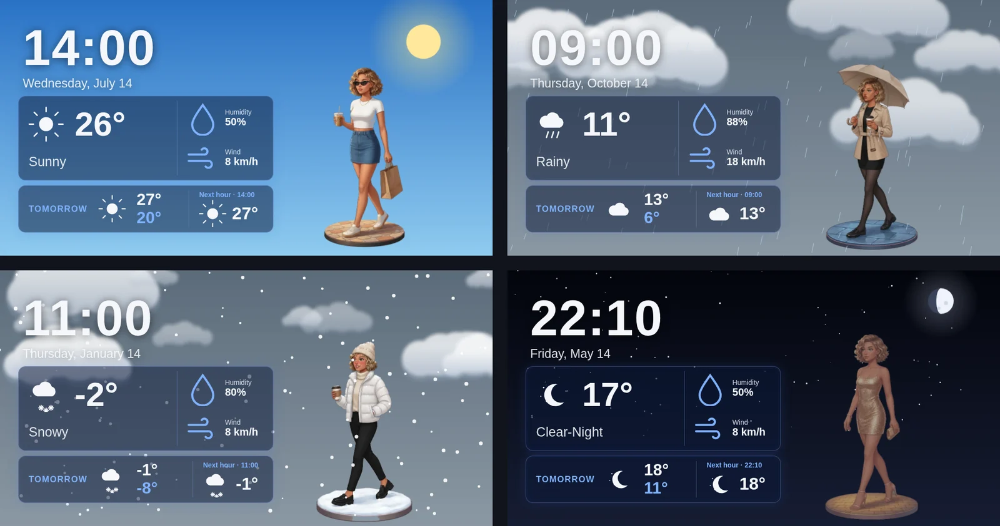
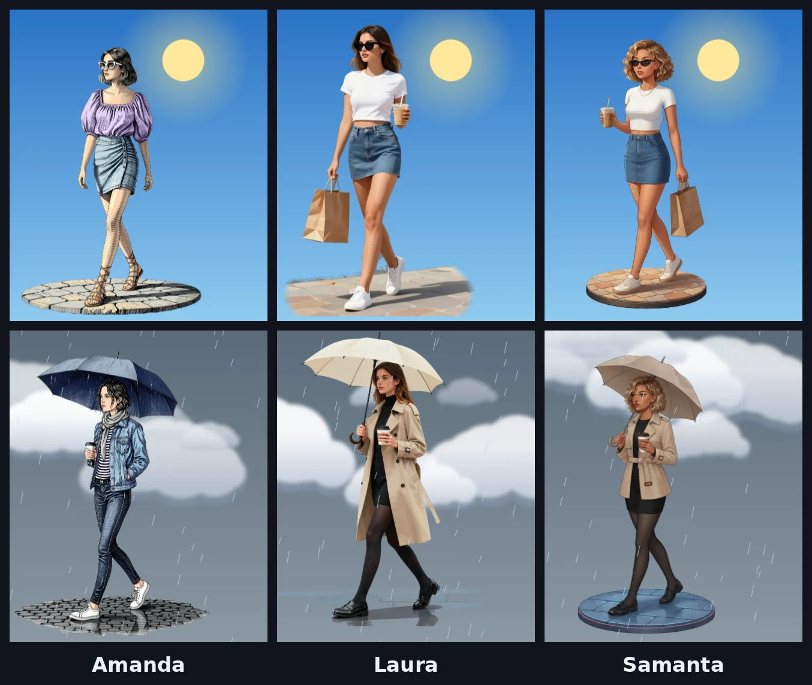
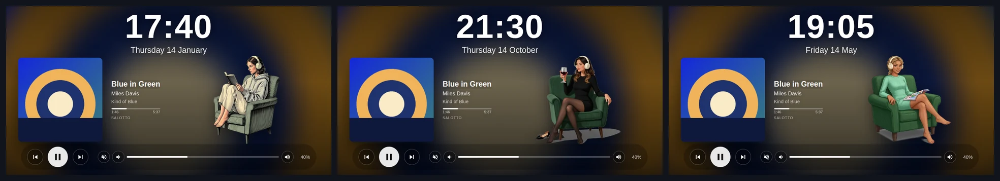

# Avatar Weather Card

A Home Assistant integration and Lovelace card that shows **an avatar dressed for the weather**: it changes outfit with the temperature, the sky, the time of day, weekends, holidays and special days, on a living sky background (sun, moon, stars, clouds, rain, snow, fog, lightning). A music view takes over while a media player plays.



> **Status: beta (0.3.2).** It works, but expect rough edges.

## What you get
- A sidebar **panel** to set everything up: weather sources, thresholds, times of day, holidays, special days, the pictures and the prompts to make them.
- A **card** for your dashboards, with a visual editor: clock, weather, tomorrow's forecast, extra sensors, the avatar, the music view with controls.
- A **picture selector** that picks the closest available picture, so a set of pictures can grow slowly.
- **Ready-to-copy prompts** for AI image generators, from one plain-text prompt file per picture set: four shared sections (style, character, pose for weather, pose for music) plus one scene per picture. Built-in prompts included; download the instructions for an AI chatbot to write your own (see [Prompts](#prompts)).

## Picture sets
The pictures are yours to choose: install a ready-made set from the catalog with one click, or make your own. Same weather, three sets (Amanda, Laura and Samanta, all in the [images catalog](https://github.com/carlosteiner/avatar-weather-card-images)):



## Music view
While a media player plays, the card turns into a music view: cover, track, progress, controls, and the avatar relaxing in her armchair, with a new picture for every song.



## Requirements
- Home Assistant 2024.7 or newer (tested on 2026.10) and a modern browser (the card uses CSS container query units).
- Pictures of the character. A default series will be available from the images repository (see *Pictures*); you can also make your own.

## Installation
### HACS (custom repository)
1. HACS → ⋮ → *Custom repositories* → add this repository, category *Integration*.
2. Install **Avatar Weather Card** and restart Home Assistant.
3. Settings → Devices & services → *Add integration* → **Avatar Weather Card**.

### Manual
Copy `custom_components/avatar_weather_card` into your `config/custom_components/`, restart, then add the integration as above.

The card is loaded by the integration on every dashboard: there is no Lovelace resource to add.

## First steps
1. Open **Avatar Weather** in the sidebar → *Settings*: tick your weather entities (give each a weight), choose the sun entity, adjust the temperature thresholds and times of day.
2. *Prompts* tab: edit the style, the character and the two poses, or load a prompt file written with an AI.
3. *Images* tab: add pictures (drag and drop; a file named like a slot, e.g. `mild_rain_afternoon.png`, keeps its name). Every cell shows what comes out, its scene (editable) and the whole prompt to copy into your image generator.
4. Add the card to a dashboard: *Add card* → **Avatar Weather Card**, or in YAML:

```yaml
type: custom:avatar-weather-card
name: Living room
height: 460
media_player: media_player.living_room   # optional: music view while it plays
sensors:                                  # optional extra panels, up to 3
  - { entity: sensor.balcony_temperature, label: Balcony, icon: thermometer, unit: "°C" }
```

### Card options
| Option | Default | |
|---|---|---|
| `name` | – | small label above the clock |
| `layout` | `cards` | `cards` (glass panels) or `classic` (bare text) |
| `height` | 420 | card height in px; everything scales with it |
| `clock_size` | 1 | size of the clock and date (also in the music view) |
| `show_clock` `show_details` `show_forecast` | true | parts to show |
| `temperature_entity` `humidity_entity` | – | replace the temperature (shown value and outfit) / humidity (shown value only) of the weather sources for this card |
| `forecast_entity` | heaviest source | weather entity for tomorrow and the next hour |
| `sensors` | – | extra sensor panels: `entity`, `label`, `icon` (thermometer, humidity, wind, pressure), `unit` |
| `media_player` / `media_players` | – | enables the music view |
| `music_controls` | true | previous / play-pause / next, mute, volume |
| `pause_grace` | 30 | seconds the music view stays after a pause |
| `avatar_x` `avatar_size` | 0.74 / 0.74 | where the avatar stands and how big she is |
| `show_picture` | false | write which picture was chosen and why (handy while testing) |

## Prompts
Each picture set has one **prompt file**: plain text divided into sections, each starting with `## NAME`.

```
## STYLE            how it is drawn and the background (shared by every picture)
## CHARACTER        who the character is (shared)
## POSE WEATHER     standing or walking, framing, the ground (weather and special-day pictures)
## POSE MUSIC       seated with headphones, framing (music pictures)
## mild_rain_afternoon
Ground: wet paving stones. A cherry-red rain jacket ... Her right hand holds a yellow umbrella ... She holds nothing else.
## mild_rain_afternoon_weekend
...
```

The prompt of a picture is STYLE + CHARACTER + the right POSE + its own scene. A set without its own file uses the built-in one
([`default-prompts.txt`](custom_components/avatar_weather_card/frontend/default-prompts.txt), a young woman with a small dog,
on a flat `#808080` grey background to key out). In the *Prompts* tab you can download the file, load another one, or go back to
the built-in one. The file travels with the set when you export, duplicate or back it up.

**Writing your own with an AI.** *Prompts* tab → **Download the instructions for an AI**. The download contains
[the guide](custom_components/avatar_weather_card/frontend/prompt-guide.md), the exact list of picture names for your
installation (your special days included) and your current file. Give it to any chatbot with your wishes (for example *"a man in
his forties with a beard, a beagle, watercolour"*), save the answer as a `.txt` file and load it with **Load a prompt file**.

## Pictures
The pictures are not part of this repository. Pictures live in **sets** (Settings tab → *Picture sets*): you can keep several, mark one as *active* (the one you edit in the **Images** tab) and let each card use a different one. Default sets are published separately (see the images repository linked from the releases) and install from the same place in one click, as new sets that never touch your own. You can also import a set from a zip, back sets up, rename them and export them to share: see [docs/SERIES.md](docs/SERIES.md). How the names work and how a picture is chosen: [docs/ARCHITECTURE.md](docs/ARCHITECTURE.md).

Pictures are served by Home Assistant without authentication (like any static path). Do not upload pictures of real people you do not want to be readable on your network, and note that some image generators refuse to work from a picture of a real person.

## Contributing
Issues and pull requests are welcome. The integration is plain Python, the panel and the card are plain JavaScript modules (no build step).

## License
Code: [MIT](LICENSE). The default pictures have their own licence (see the images repository).
